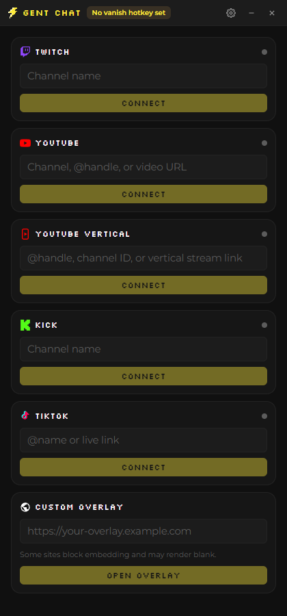

<p align="center">
  
</p>

<h1 align="center">GENT Chat</h1>

<p align="center">
  Transparent chat and viewer overlay for streamers. Twitch, YouTube, YouTube Vertical, Kick and TikTok in one window.
</p>

---

GENT Chat is a fork of [Ghost Chat](https://github.com/Enubia/ghost-chat) by Marco Schuster (Enubia), used under
the terms in [LICENSE.md](LICENSE.md). All credit for the original app goes to him. This fork is not affiliated with
or endorsed by the Ghost Chat project; please do not send its author bug reports about it.

<p align="center">
  
</p>

## What it does

- **One window, five chats.** Type a channel name or paste a link for Twitch, YouTube, YouTube Vertical, Kick and
  TikTok. Messages from every connected platform appear in one list.
- **Transparent overlay.** Vanish mode hides the window frame and background, leaving only chat and viewer counts
  on top of your game. Clicks pass through, so set a vanish hotkey under Settings > General first.
- **Viewer bar.** Total live viewers, then one count per connected platform. It can be switched off under
  Settings > General.
- **No accounts.** The app asks for no login, key or token. It reads public chat and public viewer counts only.

## What this fork changes

- **TikTok chat.** Type `@name` or paste a TikTok live link. The app talks straight to TikTok; no third-party
  signing service, key or account.
- **YouTube Vertical.** A second YouTube connection for the vertical stream. Give it the same channel as the
  YouTube card and it finds the second live stream by itself, or paste the vertical stream's link.
- **Viewer bar.** See above.
- **GENT look.** Near-black menus, yellow accent, Silkscreen headings. The overlay itself stays transparent.
- **Removed.** The bug-report sender, the update checker, and Twitch login (channel-point redemptions), because
  each of them pointed at the original author's services or Twitch app.
- **Own identity.** Settings live in `%APPDATA%\gent-chat`, so an installed Ghost Chat is never touched.

Windows only. Version 4.10.0, continuing Ghost Chat's numbering from 4.9.0.

## How the viewer counts work

Every count comes from a public endpoint that needs no login. None of them is an official API, so any of them can
stop working when the platform changes it. When that happens the last good number stays for two minutes, then
that platform shows `–`; chat is never affected.

## Build

Needs Go 1.26+, Node.js 20+, pnpm, and the Wails v3 CLI
(`go install github.com/wailsapp/wails/v3/cmd/wails3@v3.0.0`). WebView2 ships with Windows 10 and 11.

```bash
go test ./...
cd frontend && pnpm install --frozen-lockfile && pnpm test && cd ..
wails3 task build        # produces bin/gent-chat.exe
```

Network checks against the real platforms are skipped by default. To run them, set `GENT_LIVE=1` and name a live
channel per platform: `GENT_TWITCH`, `GENT_KICK`, `GENT_TIKTOK`, `GENT_YOUTUBE_VIDEO` (a video id) and
`GENT_YOUTUBE_CHANNEL` (a channel `/live` link with two streams live), then `go test ./... -run TestLive -v`.
Every sample under `testdata/` is made up; none is a capture of a real stream.

## Licence

[DBAD Public License 1.2](LICENSE.md), the same licence as Ghost Chat.
